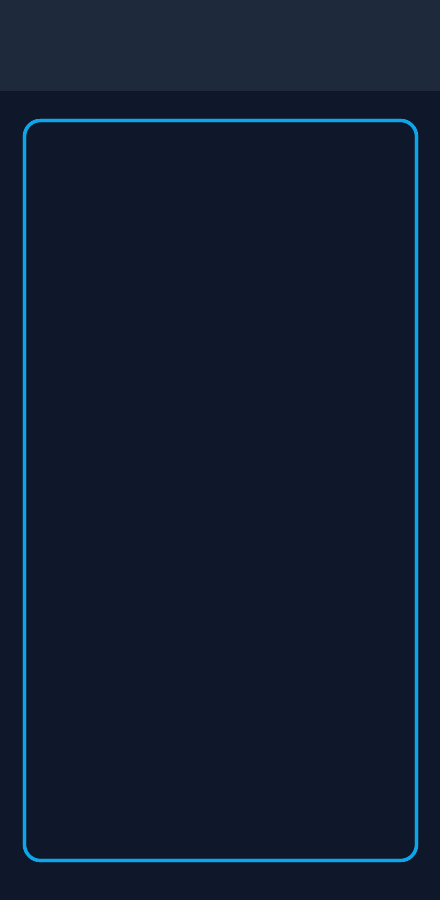
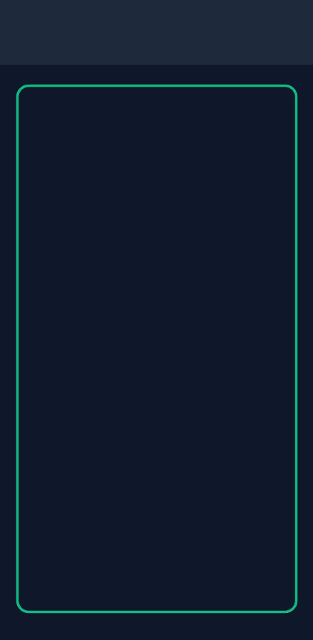
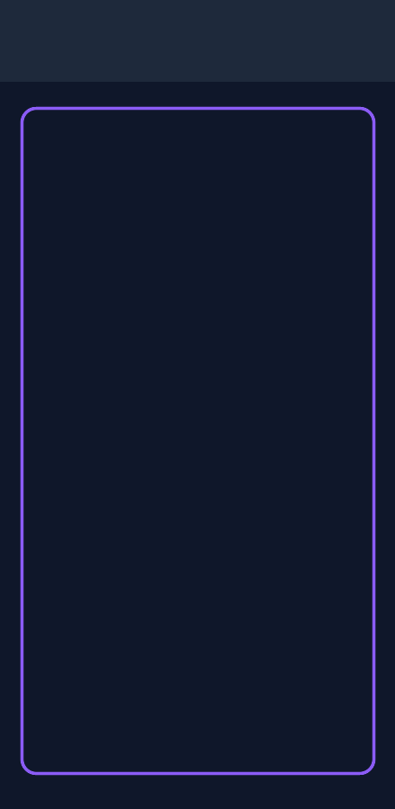
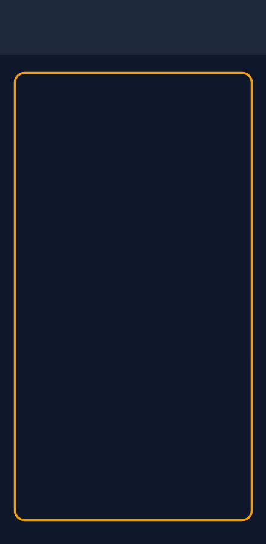
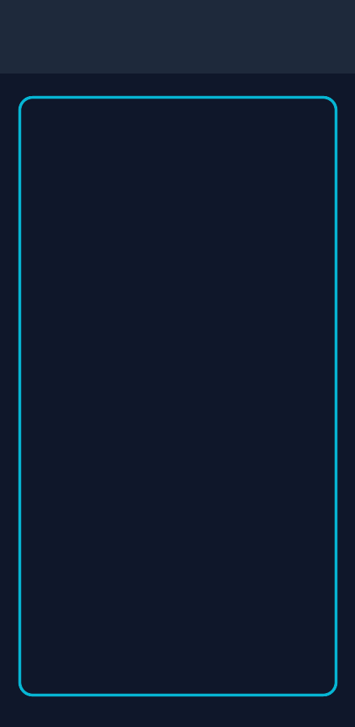
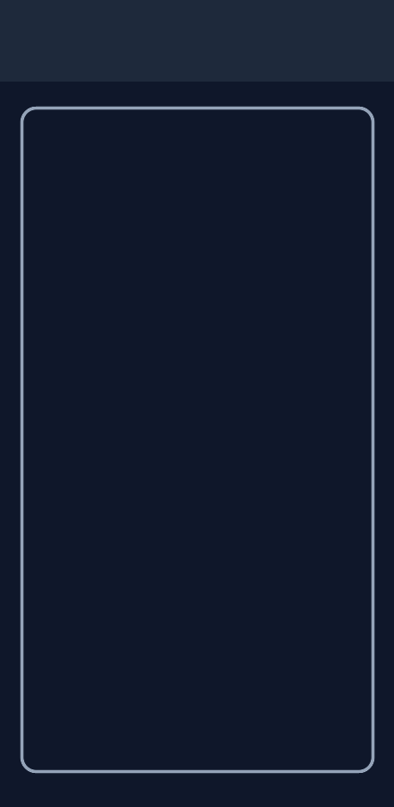
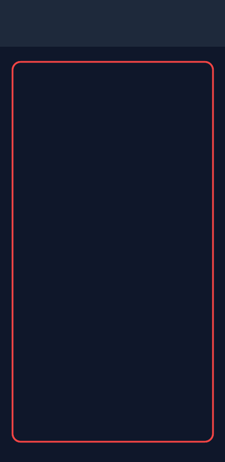

# 🛡️ FocusGuard — Digital Wellness & Commitment Lock

FocusGuard is a native Android application built with **Kotlin**, **Jetpack Compose**, and **Material 3 (Material You)** for Android 8.0 (API 26) and above. It provides unbreakable app restrictions, digital detox programs, biometric security, and a tamper-resistant 7-day commitment lock designed to overcome digital addiction and protect your attention.

---

## 📱 Screenshots

> In compliance with Android OS security policies and `FLAG_SECURE` window protection, system biometric prompts (fingerprint/face scan) are protected against screen capture. FocusGuard's salted PIN keypad serves as the secure, inspectable authentication surface.

| Home Dashboard | App Restrictions | Digital Detox Protocol | New Detox Program |
|:---:|:---:|:---:|:---:|
|  <br><sub>*Today's focus status & active rules*</sub> |  <br><sub>*Search & restrict installed apps*</sub> |  <br><sub>*Daily check-in & reduction roadmap*</sub> |  <br><sub>*Custom goals & 7-day lock*</sub> |

| Screen Time Analytics | Settings & Permissions | FocusGuard App Lock |
|:---:|:---:|:---:|
|  <br><sub>*7-Day usage activity bar chart*</sub> |  <br><sub>*System permissions & security toggles*</sub> |  <br><sub>*Salted PIN security keypad*</sub> |

---

## ✨ Key Features

### 1. ⏱️ App Restriction Controller
- **Installed Apps Discovery**: Lists all installed user applications with search and category filters (*Social & Video, Games, Productivity, Other*).
- **Three Restriction Modes**:
  - **Daily Limit Only**: Set a maximum daily usage quota in minutes (e.g., 45 min/day).
  - **Allow Only in Window**: Restrict access to designated hours (e.g., 9:00 PM to 10:00 PM), with full support for overnight windows (e.g., 21:00 to 02:00).
  - **Block Completely**: Enforce total restriction during selected days.
- **Day-of-Week Schedule**: Enable rules on specific days (Monday–Sunday).
- **In-Session Real-Time Cutoff**:
  - Calculates live usage using high-resolution Android `UsageEvents` (`ACTIVITY_RESUMED`, `ACTIVITY_PAUSED`, `MOVE_TO_FOREGROUND`, `MOVE_TO_BACKGROUND`), including the currently active running session.
  - Schedules exact alarms via `AlarmManager.setExactAndAllowWhileIdle()` and background handlers to fire the exact second the limit is reached.
  - While a restricted app is active in the foreground and the screen is on, a 1-second continuous check acts as a real-time safety net.
- **Zero-Latency Enforcement**: Powered by `FocusGuardAccessibilityService` monitoring both window transitions and content changes (`typeWindowStateChanged | typeWindowContentChanged`).
- **5-Minute Advance Warnings**: Delivers warning notifications 5 minutes before your daily limit runs out.

### 2. 🔒 App Lock & Hardware Keystore Security
- **Salted PIN Hashing**: Uses cryptographically secure random salt (PBKDF2 / SHA-256) and constant-time equality checks to prevent timing attacks.
- **Biometric Authentication**: Fingerprint and Face Unlock support via AndroidX `BiometricPrompt` with automatic PIN fallback.
- **Dual Lock Surface**: Protect FocusGuard itself from unauthorized configuration changes, and optionally lock individual apps behind the PIN/biometric screen.
- **Recents Screen Masking**: Flags all activity windows with `WindowManager.LayoutParams.FLAG_SECURE` to blank out sensitive app contents in the system multitasking/recents screen.
- **Auto-Lock on Leave**: Automatically re-locks protected screens when the app goes into the background.

### 3. 🌱 Addiction Remover (Digital Detox Programs)
- **Guided Setup Wizard**: Pick an area to reduce:
  - *Short-Form Video & Reels* (Instagram, TikTok, YouTube Shorts)
  - *Endless Mobile Gaming*
  - *Social Media Reset*
  - *Custom Focus Protocols*
- **Gradual Reduction Schedules**:
  - **Gentle**: 3 days per step, -10 min daily reduction.
  - **Moderate**: 2 days per step, -15 min daily reduction.
  - **Strict**: 1 day per step, -25 min daily reduction.
  - Target maintenance step once your goal is reached.
- **Automatic Restriction Sync**: The generated reduction schedule automatically syncs into active restrictions in the blocking engine.
- **Mindful Pause Screen**: When opening a detox-monitored app, presents a breathing circle exercise with a mandatory 10-second reflection countdown before allowing temporary entry.
- **Gamified Progress**: Streak tracking, time saved odometer, daily check-ins, and milestone badges (*First Step, 3-Day Warrior, 7-Day Champion, Time Reclaimed, Zen Master*).

### 4. 🛡️ 7-Day Commitment Lock & Anti-Cheat
- **Unbreakable 7-Day Lock**: Once committed, rule settings cannot be loosened, deleted, paused, or extended for 7 full days.
- **Stricter-Only Rule Modifications**: During an active commitment, users are permitted to make rules stricter (decrease allowed minutes or add days), but cannot loosen them.
- **Real-Time Countdown**: Live countdown timer displayed on locked cards (e.g., *"Unlocks in 5d 3h"*).
- **Hardware Monotonic Clock Tamper Detection**: Compares system wall time against monotonic `SystemClock.elapsedRealtime()`. If device time is rolled backwards or skipped forward by days to cheat the countdown, the anomaly is detected, flagged, and locked.
- **Device Administrator Protection**: Optional `FocusGuardDeviceAdminReceiver` integration prevents uninstallation while a commitment lock is active.

### 5. 📊 Analytics & Debug Logs
- **7-Day Activity Chart**: Custom Canvas bar chart showing weekly screen time trends.
- **Per-App Breakdown**: Visual progress bars, launch durations, and percentage of daily usage.
- **Real-Time Block Events Log**: Dedicated debug log table and UI panel tracking every scheduled cutoff, fired block, and reason for complete visibility.

### 6. ⚙️ Reliability & OEM Optimization
- **Foreground Service**: `FocusGuardMonitoringService` keeps monitoring resilient with a persistent low-profile notification.
- **Reboot Persistence**: `BootReceiver` restarts protection automatically on `BOOT_COMPLETED`.
- **OEM Battery Guide**: Detailed in-app troubleshooting instructions for Samsung OneUI, Xiaomi MIUI/HyperOS, Oppo/Realme ColorOS, and Vivo FuntouchOS.

---

## 🏗️ Architecture & Tech Stack

- **Architecture**: MVVM (Model-View-ViewModel) + Repository Pattern + Clean Architecture
- **UI Toolkit**: Jetpack Compose, Material 3 (Material You), Dynamic Color (Android 12+)
- **Local Persistence**: Room Database (entities: `AppRestriction`, `DetoxPlan`, `BlockEvent`)
- **Key-Value Settings**: AndroidX DataStore Preferences
- **Security**: Android Keystore, PBKDF2/SHA-256 Salted Hashes, BiometricPrompt
- **Background & Enforcement**:
  - `FocusGuardAccessibilityService` (Foreground app detection & window content change observer)
  - `FocusGuardMonitoringService` (SpecialUse foreground service)
  - `CutoffScheduler` (`AlarmManager.setExactAndAllowWhileIdle` + Handler fallback)
  - `CutoffReceiver` (`BroadcastReceiver`)
  - `FocusGuardDeviceAdminReceiver` (`DeviceAdminReceiver`)

---

## 🚀 Setup & Installation

### Requirements
- **Android Studio**: Iguana (2023.2.1), Ladybug, Meerkat, or newer.
- **Gradle**: Kotlin DSL (`build.gradle.kts`).
- **JDK**: Java 17 or Java 21.
- **Device / OS**: Android 8.0 (API 26) or higher.

### 1. Build and Run via Android Studio
1. Clone or extract this repository into your workspace.
2. Open Android Studio and select **File > Open...** targeting the project root.
3. Wait for Gradle sync to complete.
4. Connect an Android device with USB debugging enabled.
5. Click **Run > Run 'app'** (`Shift + F10`).

### 2. Build via Command Line
```bash
# Run local unit and logic tests
gradle :app:testDebugUnitTest

# Assemble Debug APK
gradle :app:assembleDebug
# Output: app/build/outputs/apk/debug/app-debug.apk

# Assemble Release APK
gradle :app:assembleRelease
```

### 3. First Launch Permissions Checklist
To ensure the app can block apps in real time and protect your focus, complete the following in the **Settings** screen:
1. **Usage Access**: Allows FocusGuard to track screen time and calculate exact limits.
2. **Accessibility Service**: Allows immediate detection when restricted apps enter the foreground and launches the block overlay.
3. **Display Over Other Apps**: Allows full-screen block and mindful pause screens to render over other apps.
4. **Notifications**: Delivers active protection status and 5-minute limit warnings.
5. **Battery Optimization Exemption**: Prevents OEM background task killers from stopping the service.
6. **Device Administrator** *(Optional)*: Protects against uninstallation during 7-day commitment locks.

---

## 🧪 Testing

The project includes unit tests covering:
- Daytime and overnight time-window calculations (`RestrictionEngine`)
- 5-minute warning notification trigger thresholds
- Gradual reduction schedules across Gentle, Moderate, and Strict intensities (`DetoxPlanGenerator`)
- 7-Day commitment lock enforcement (allowing stricter edits and rejecting looser edits/deletions)
- Countdown formatting and monotonic clock tampering detection (`CommitmentLockValidator`)
- In-session live usage calculations and cutoff trigger conditions

To execute all tests:
```bash
gradle :app:testDebugUnitTest
```

---

## 📄 License
This project is licensed under the Apache License 2.0.
